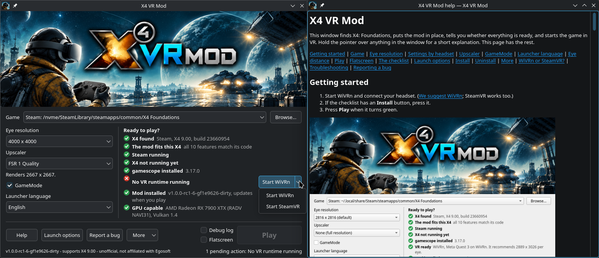
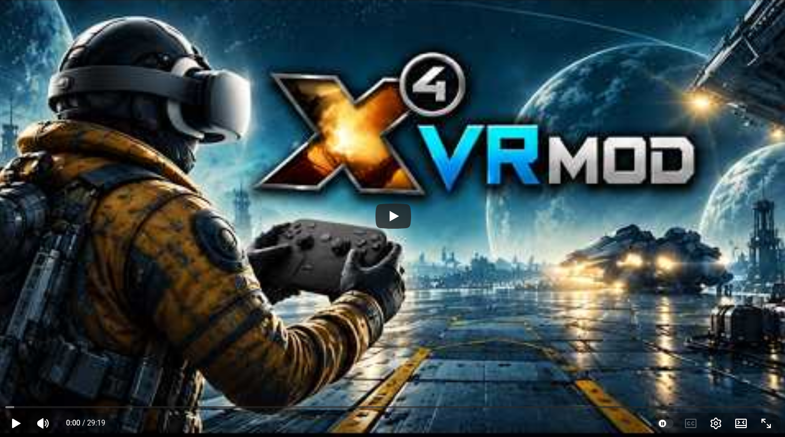

# X4VRMOD

A VR mod for **X4: Foundations** on native **Linux**, aiming at true
in-engine stereoscopic 3D by intercepting the game's own Vulkan rendering —
rather than reconstructing depth after the fact.

Three components: a **Vulkan layer** (stereo, cameras, VR submission), an
**`LD_PRELOAD` injector** (config, game state, effects), and a **cursor shim**
(so menus and dialogs stay usable in VR). Design and phased roadmap in
**[DESIGN.md](DESIGN.md)**; engine reverse-engineering notes in
**[docs/frame-analysis.md](docs/frame-analysis.md)**; the traps X4 sets for
modders in **[docs/x4-quirks.md](docs/x4-quirks.md)**.



[](https://youtu.be/peyWke7Wa-8)


* **Easy to install, update and remove.** Packages for Arch, Ubuntu 24.04 and 26.04, Debian 13 and Fedora, plus a zip for anything else. Run the launcher and select the game's directory (if it's Steam, it's autodetected), then one button installs or updates the mod. Uninstalling lists what it will remove, then removes exactly that (the Vulkan layer and the X4 extension included), and can delete the mod's VR settings too. Your saves are never touched.
* **A launcher that checks everything first**: X4, Steam, gamescope, the VR runtime and headset, the GPU, the mod itself. A list of pending actions says what's missing, and Play turns green when everything is in place. It warns about overlays and frame generators that would get in the way, and it comes with a short illustrated manual. The headset shows a loading screen while X4 starts.
* **VR kept apart from your flat game.** In VR, X4 gets its own settings and controls, and your flat settings are never touched; both play the same savegames. Start VR from the launcher, from Steam's launch options or from a terminal, and the launcher's Flatscreen box runs plain X4.
* **The launcher in English, Brazilian Portuguese, French, Russian and German**, including the help; these are the languages X4 has voice acting in. All of X4's 14 languages are planned for the future (but we'll need testers).
* **True stereo from the engine.** Both eyes come from the same frame and the same game state, so there's no ghosting from eyes drawn a frame apart and no depth guessing. Shadows, volumetric nebulae and ship interiors hold up in stereo.
* **X4's engine rewired from the inside.** Its shaders are patched to draw both eyes in one pass (Vulkan multiview), with each eye's projection built in, so the second eye's geometry adds no per-frame work. X4's own code is patched where it has to behave like a VR engine: cameras, walking, external views, aiming, menus and shadows. Every patch checks X4's bytes first and stays off if they don't match.
* **6DOF head tracking.** Look around and lean in the cockpit; on foot your head looks while the mouse turns your body. It drives X4's own free-look camera, so hovering over and clicking things in the world still works. The eye distance follows your headset's IPD setting as you change it.
* **The whole UI in VR.** The HUD stays fixed to the cockpit where X4 puts it, and you click it where you see it. Every menu (map, station builder, ship configuration, trading, dialogues) lines up with the pointer, and mouse steering aims at its ring.
* **The mod's own cursor and mouse shim**: the pointer is drawn at the UI's depth in both eyes and clicks land where it appears.
* **Sharp menus when streaming.** Full-screen menus are redrawn for where you look, so a streamer's sharp centre (WiVRn's foveated encoding, Steam Link) follows your eyes across the map.
* **Stellar performance.** As this mode in practice reimplements X4's engine in VR, with no wasted draws or waiting periods, performance is as good as possible, with no frequency restrictions or oddities. You can have variable framerate with no issues and getting close to a busy station will not hang or desync your gameplay.
* **External and cinematic views.** F2/F3/F4 become the whole scene, with your head turning the camera; F6 is a steady window with its overlay. Even the start menu is a stereoscopic window.
* **X4's upscaling still works**: X4's FSR 1, FSR 3 and for NVIDIA RTX owners, DLSS, all chosen from the launcher.
* **Compatibility with most regular extensions**: this mod actually carries only a small extension which changes cockpit camera's settings, so collisions or incompatibilities with other extensions and mods are unlikely. Reports are welcome!
* **Debug logs and a one-click bug report**, cleaned of personal paths. Nothing is sent anywhere; you attach it yourself.

**Needs:** X4: Foundations 9.00 (Steam or GOG) running natively on Arch, Ubuntu, Debian, Fedora or another distro; a Vulkan capable GPU; gamescope; and a headset on WiVRn or SteamVR (ALVR might also work). Played on a Quest 3 over WiVRn and Steam Link. **Not supported:** Running X4 through Proton, and Steam installed as a Flatpak. As it carries a small extension, X4 marks saves played with this mod as modified.

Unofficial, not affiliated with Egosoft, open source (GPL-3.0): https://github.com/Patola/X4VRMOD · Release: https://github.com/Patola/X4VRMOD/releases/tag/v1.0.0-rc2

It's a release candidate, so reports from other machines and headsets are what I need most. The launcher makes the bug report for you.

**How it got here.** This is my fourth attempt, each one started from scratch. The earlier ones went the usual routes: SuperDepth3D's depth reconstruction, alternate-eye rendering, and OpenTrack for the head. I played them enough to know their limits: ghosting, a head that turned around the wrong point, gimbal lock, depth that broke up around the HUD, and a setup that fell apart easily. [Here's the first one](https://youtu.be/lyjp4NC8BW4), in June, to show how cumbersome it was. Those limits are why this one goes into the engine instead. To get to this point, it cost me upwards of 400h coding with AI plus about 80h of in-game testing and measurements distributed in 426 takes. The mod has more than 40,000 lines in C++ (excluding comments), 13,500+ lines in python and 5,000+ lines in shell script.

**Future Plans** 
* So some people could call this a "fake VR" mod because it doesn't use the **tracked controllers** and **Virtual Reality Inverse Kinematics (VRIK)** to infer the whole body, right? Right... FOR NOW. As this mod implements its own renderer, it is entire in the realm of possibility to add these, with floating panels, virtual controls, tactile hand interactions and complete body freedom. And indeed, it's issue 1 (Feature Request) on our issue tracker, with illustrated descriptions of what is planned: https://github.com/Patola/X4VRMOD/issues/1. But don't hold your breath: I expect this to be a very long endeavour, likely to take one year or more. When it's done, it will be a toggleable option: you will always have the option to play it on your controllers or keyboard and mouse.
* Use of **frame generation** + **anti-lag** is being considered. Anti-lag is less effective in VR though.
* Following this announcement, will also try and get this mod on the repository of most distributions, starting by the **AUR** from Arch.

**Disclaimer**: Claude Code was used for code assistance, and also for helping creating the first draft of this post (which I altered substantially). Gemini was used for the X4VRMOD logo and artwork.

> **Status: v1.0.0-rc3 — the third release candidate for 1.0, playable in VR** ([release notes](docs/releases.md)).
> X4 runs in VR with in-engine stereo (per-eye lighting), head-look and lean
> in the cockpit, head-look on foot, the UI on a canvas at the angle X4
> intended, every menu reachable and lined up with the cursor, and the
> cockpit HUD clickable where it is drawn, over WiVRn or SteamVR. Mouse
> steering targets at its ring. The external views (F2/F3/F4) are the whole
> scene too, and the cinematic view (F6) a steady window with its overlay
> filling it. X4's upscalers, FSR 1 and FSR 3, work in both eyes
> ([how to choose](#resolution-and-upscaling)). A launcher, in five languages,
> installs it and starts it ([install](#install)). Next: 1.0, once this release
> candidate has been played on other people's machines. The start menu as the whole
> scene is an optional future feature. An earlier proof of
> concept using OpenTrack head-tracking + vkShade/SuperDepth3D depth-image
> reconstruction is preserved
> at tag `v0.1`; it was abandoned as a dead end (wrong pivot, gimbal lock,
> fragile setup, DIBR artifacts).

## How it works

X4 renders one mono view. To make two eye views *with correct per-eye
lighting*, the mod intercepts the engine rather than post-processing it:

- The **injector** gives X4 its own settings file. On first run it forks your
  `config.xml` into `config-x4vrmod.xml`; after that, every read is answered
  from the profile with the VR overrides applied **in memory** (2:1
  side-by-side — 5632×2816 for two 2816² eyes in the current setup — with
  VR-hostile effects off), and every write X4 makes
  is redirected into the profile. **Your `config.xml` is read once and never
  written**, so vanilla launches are untouched — and settings you change
  in-game while modded still persist. To uninstall, delete the profile.
- **gamescope** provides a virtual display so the game can render larger than
  the monitor, with the mouse still confined correctly. It is **required**,
  not a convenience: X4 honours `res_width`/`res_height` only when
  `borderless` is off, and then loses the titlebar height (1408 → 1385);
  with `borderless` on it ignores them and sizes to the display. Setting the
  display to exactly the requested size is what makes the two agree, and the layer
  warns if the swapchain comes up any other size.
- The **Vulkan layer** patches X4's vertex shaders (SPIR-V) to apply a
  constant clip-space matrix per eye, and patches the per-view constants so
  the deferred lighting matches each eye.

### The key insight

X4 renders **camera-relative** — `M_view` is identity, and geometry is
positioned by a per-object, CPU-baked `M_worldviewprojection`. That means an
eye offset `d` is a pure view-space translation, so the whole per-eye
transform collapses to a single constant matrix applied in clip space:

```
clip_eye = K_eye · clip        K_eye = P · T(−d) · P⁻¹
```

`K_eye` only changes when IPD, FOV or resolution change, so it is **baked
into the patched shaders** — the per-frame cost of stereo geometry is zero.
This is why the mod does not need to touch the ~1300 per-object constant
blocks every frame.

## Where it stands

| Milestone | State | Tag |
|---|---|---|
| Harness, frame mapped, config forked in memory (yours is never written) | done | `config_profile_done` |
| Correct stereo with per-eye lighting; X4's own pointer in each eye | done | `stage2-stereo-shading-correct`, `stage3-cursor-in-eye` |
| X4 in a headset: eye image submitted to an OpenXR runtime | done | `stage9-first-light` |
| Head tracking, closed loop on X4's own camera read-back | done | `stage12-headtracking-working` |
| Stereo stays horizontal under head roll | done — but see note | `take-221-roll-stereo` |
| UI at the angle X4 lays it out for (the sliding HUD fixed) | done | `take-268-ui-field` |
| UI fuses wherever there is a HUD | done | `take-274-canvas-far` |
| SteamVR as well as WiVRn | done | `take-303-steamvr` |
| Shadows stable at 110° (X4 sizes its cascades by 1/tan) | done | `take-325-shadows-fixed` |
| Head-look by writing X4's free-look (hover works with it) | done | `take-321-headlook-write` |
| Cursor shim: pointer usable in cockpit and menus | done | `take-330-menus-reachable`, `take-343-right-click` |
| Mouse-steering target fixed to the cockpit | done | `take-333-steering-a` |
| Walking: the head looks, the mouse and arrows turn the body | done | `take-338-walking-b` |
| On-foot menus, dialogues, teleporters and vendors lined up | done | `take-341-foot-menu-start` |
| **Playable in VR** | **release** | **`v0.9.0`** |
| F6 (cinematic) a steady window, as X4 intends | done | **`v0.9.4`** |
| F6's overlay fills its window | done | **`v0.9.5`** |
| The cockpit HUD clicks where it is drawn; steering targets at the ring; lean in the cockpit | done | **`v0.9.6`** |
| Larger eyes: the HUD stays put; the map draws (flat above ~4068² per eye, X4's 255.8 MiB pool block) | done | **`v0.9.7`** |
| FSR 1 in both eyes (`X4VR_UPSCALE=fsr_*`) | done | **`v0.9.8`** |
| FSR 3 in both eyes (`X4VR_UPSCALE=fsr3_*`) | done | **`v0.9.8`** |
| The Pause key keeps the cockpit and walking immersive | done | **`v0.9.8`** |
| The shipping line is the default: `./launch/x4vr-launch.sh` with nothing set | done | **`v0.9.9`** |
| Interior lights steady in VR (no flicker in ship interiors) | done | **`v0.9.9`** |
| One X4 extension, `x4vrmod`; version in every log; C++ runtime linked in | done | **`v0.9.9`** |
| GOG's X4, and hotfixes that only move code | done | **`v0.9.10`** |
| The launcher window, packages and a zip | done | **`v0.9.10`** |
| The eye distance from the headset, following its dial | done | **`v0.9.10`** |
| DLSS in both eyes (`X4VR_UPSCALE=dlss_*`) | not yet played in a headset | **`v0.9.10`** |
| GameMode | done | **`v0.9.10`** |
| Full-screen menus sharp to their edges when streaming (the streamer's sharp middle follows your gaze) | done | **`v1.0.0-rc1`** |
| The launcher and its help in English, Brazilian Portuguese, French, Russian and German | first draft, corrections welcome | **`v1.0.0-rc1`** |
| The headset shows the mod's picture and "X4 is loading" until X4 draws | done | **`v1.0.0-rc2`** |
| The launcher warns about frame generators and overlays that would load into X4 | done | **`v1.0.0-rc2`** |
| The start menu as the whole scene (menu at its size in front, the 3D scene all around) | optional, future — not scheduled | — |
| The desktop view optional while in the headset (est. 3–5% fps; [DESIGN.md](DESIGN.md#late-features-postponed-not-scheduled)) | late feature, postponed | — |
| Volumetric nebula in stereo (Matrix #79B, CEO's Doubt) | done | **`v0.9.1`** |
| The numpad orbits the external (F2) and target (F3) views again | done | **`v0.9.2`** |
| F2/F3/F4 as the whole scene: the head turns X4's camera inside them | done | **`v0.9.3`** |
| Frame pacing at 2816² per eye (a 90 Hz display is starved) | open | — |
| Head translation (lean) | done — in the world shaders, X4's eye stays put (`X4VR_HEAD_6DOF`) | **`v0.9.6`** |

**Note on roll stereo:** it needs `X4VR_POSE=1`. Between takes 260 and 315
the working command line carried `X4VR_POSE=0`, so it was inactive (see *"Roll
stereo has been OFF since take 260"* in [docs/x4-quirks.md](docs/x4-quirks.md));
the v0.9.0 command line carries `X4VR_POSE=1` and `X4VR_ROLL_STEREO=1`.

The engineering record — every take, prediction, and wrong turn — is
[docs/x4-quirks.md](docs/x4-quirks.md); the tagged states and their exact
command lines are in [docs/known-good-runs.md](docs/known-good-runs.md).

X4's UI shaders don't merely declare the same descriptor set as world
geometry — they genuinely *read* it, so no static shader analysis can tell
them apart. Both the UI and the shadow cascades are instead excluded at
**pipeline creation**, where they are cleanly separable by render pass. This
matters beyond appearance: X4 hit-tests its UI on the CPU in unshifted screen
space, so shifting UI on the GPU alone moves what you see away from what you
can click. Any VR repositioning of menus must therefore go through the cursor
shim, not the layer — see [docs/frame-analysis.md](docs/frame-analysis.md).

## Requirements

- **X4: Foundations**, native Linux build (developed against 9.00)
- A **Wayland** session, **gamescope**, and a Vulkan 1.3+ driver
- For the VR phases: an OpenXR runtime (**WiVRn**/Monado, or SteamVR)
- Build: CMake ≥ 3.20, a C++17 compiler, Vulkan headers, OpenXR headers
  (optional — without them the VR paths are skipped, and the OpenXR *loader* is
  never linked in any case: it is `dlopen`'d, so a machine with no runtime
  installed still runs the mod flatscreen)

## Install

Download a package or the zip from the
[releases page](https://github.com/Patola/X4VRMOD/releases): Arch, Ubuntu 24.04, Ubuntu 26.04,
Debian 13 and Fedora each have their own, named for the system, and the zip is for anything
else. Steam installed as a Flatpak isn't supported: its sandbox can't reach the mod, and it makes
VR harder for every game. It isn't planned for now, and may come if players ask for it. Then start `x4vrmod-launcher`, which shows what's
ready and what isn't. For the zip, unpack it and start it from that folder.

## Build & run

```sh
cmake -S . -B build && cmake --build build
./launch/x4vr-launch.sh                 # X4 in VR, 2816² per eye, native
X4VR_H=4224 X4VR_UPSCALE=fsr_quality ./launch/x4vr-launch.sh  # 4224², FSR 1
```

**The shipping settings are the defaults.** The launcher applies
`launch/defaults.conf` (the take 375 line) to every variable you have not
set. An explicit setting always wins (`X4VR_MV=0` turns one off), and
`X4VR_DEFAULTS=0` applies none of them, which is how takes before 385 ran.

The launcher sets `SteamAppId`, the usual dev flags
(`-skipintro -nocputhrottle -nosoundthrottle`), core dumps, and the layer /
preload environment. It also works as a Steam launch-option wrapper:
`/path/to/launch/x4vr-launch.sh %command%`. Logs go to `/tmp/x4vr.log`
(`X4VR_LOG=` sends them to stderr instead).

Useful switches: `X4VR_NO_LAYER=1`, `X4VR_NO_INJECT=1`, `X4VR_NO_CONFIG=1`
(bisect a problem), `X4VR_X11=1` (force the SDL X11 path),
`X4VR_CLIP_SHIFT=<x>` (clip-space test shift), `X4VR_DUMP_MATRICES=1`,
`X4VR_FOV=<decimal>` (serve X4's `<fov>` from the profile — the field of view is
a config setting, so widening it needs no projection patch),
`X4VR_LUA=1` (log every Lua chunk X4 loads, and which of them mention a camera
API — reconnaissance for reading X4's camera back instead of driving it blind),
`X4VR_HEADLOOK=1` (serve X4's `inputmap.xml` from a fork with free-look rebound
onto a key of our own, so the head can drive it without spending shift and the
middle mouse button; `X4VR_HEADLOOK_KEY=<INPUT_KEYCODE_…>` picks the key,
default `INPUT_KEYCODE_F13`, which works — X4 knows F13-F15 and no keyboard can
emit them, so the mod steals no usable key; `X4VR_HEADLOOK_RAW=191` supplies its
X11 keycode, which is the evdev code plus 8),
`X4VR_CAMREAD=1` (read X4's own camera back through its exported
`GetCameraRotation`) and `X4VR_CAMLOOP=1` (let that reading *drive* the servo
rather than only be reported — this is what makes head tracking track),
`X4VR_PROJ_MVP=0` (turn *off* the per-draw `sx` recovery for the World shaders
that declare no camera block — on by default since takes 109/110; with it off
they shear by a constant that is only right at one zoom level),
`X4VR_VR=1` (bring an OpenXR session up on X4's own device — off by default,
needs a runtime *running*; submits nothing yet, so the headset shows the
runtime's idle scene while X4 renders to the monitor as usual).

## Resolution and upscaling

**Eye size.** Set `X4VR_H`; the other two follow it unless you set them
yourself. The eyes are square:

| Variable | Meaning | Example (2816² eyes) | Example (4224² eyes) |
|---|---|---|---|
| `X4VR_H` | one eye's height and width (default 2816) | `2816` | `4224` |
| `X4VR_W` | the side-by-side window: 2 × `X4VR_H` | `5632` | `8448` |
| `X4VR_RES` | X4's resolution: `X4VR_H`x`X4VR_H` | `2816x2816` | `4224x4224` |

The shipping line (take 375 in [docs/known-good-runs.md](docs/known-good-runs.md))
uses 2816² per eye. Two limits are known at larger sizes:
* Above about 4068² per eye the map is drawn flat, the same image in both
  eyes. It is too big, doubled, for X4's 255.8 MiB memory block.
* SteamVR garbles the image at 4224² per eye; WiVRn does not.

**Upscaling.** `X4VR_UPSCALE=<mode>` chooses X4's upscaler, which renders the
scene smaller and scales it up to the eye size. The default is `none`: X4
renders every pixel, at any eye size. The mod owns this setting and serves it on every launch,
so a change in X4's graphics menu lasts only until the next launch. Frame
generation is always served off: an interpolated frame carries no head pose
and adds latency.

| `X4VR_UPSCALE` | Upscaler | Renders at (eye ÷) |
|---|---|---|
| `none` (or unset) | none | 1 |
| `fsr_ultra_quality` | FSR 1 (spatial) | 1.3 ¹ |
| `fsr_quality` | FSR 1 | 1.5 (measured: 2816² for a 4224² eye) |
| `fsr_balanced` | FSR 1 | 1.7 ¹ |
| `fsr_performance` | FSR 1 | 2 ¹ |
| `fsr3_native` | FSR 3 (temporal), anti-aliasing only | 1 ¹ |
| `fsr3_quality` | FSR 3 | 1.5 ¹ |
| `fsr3_balanced` | FSR 3 | 1.7 (measured: 2484² for a 4224² eye) |
| `fsr3_performance` | FSR 3 | 2 ¹ |
| `fsr3_ultra_performance` | FSR 3 | 3 ¹ |
| `dlss_auto` | DLSS, X4 chooses the mode | depends on the size |
| `dlss_dlaa` | DLSS, anti-aliasing only | 1 |
| `dlss_quality` | DLSS | 1.5 ¹ |
| `dlss_balanced` | DLSS | 1.72 ¹ |
| `dlss_performance` | DLSS | 2 ¹ |
| `dlss_ultra_performance` | DLSS | 3 ¹ |

¹ AMD's or NVIDIA's standard ratio, not measured here.

A value outside the list is rejected and `none` is served; the log says
which (`config: upmode: …`). Both upscalers run in both eyes:
* FSR 1 since take 380, through `X4VR_FSR_STEREO`;
* FSR 3 (AMD FidelityFX) since take 383, through `X4VR_FFX_STEREO`.

Both are on by default; set either to `0` only to compare.

**DLSS needs an NVIDIA RTX card, and is best effort: it hasn't been played in a headset.**
The launcher offers it only with such a card. X4 calls NVIDIA's code directly, so when a
`dlss_*` mode is asked for, the mod patches those three calls to run it again for the right
eye, with its own history (`injector/x4vr_ngx.hpp`). No other session is patched. X4 9.00
ships DLSS 3.7.20 in its own `lib/` folder.

Measured at 4224² per eye on an RX 7900 XTX (different scenes, so rough):

| Mode | Frame time |
|---|---|
| none | 29.1 ms |
| `fsr_quality` | 13.24 ms (take 380) |
| `fsr3_balanced` | 16.72 ms (take 383) |

For example, `X4VR_H=4224 X4VR_UPSCALE=fsr_quality ./launch/x4vr-launch.sh`
is 4224² eyes with FSR 1 Quality, and `X4VR_UPSCALE=fsr3_balanced` the same
with FSR 3 Balanced; `X4VR_H=3072` alone is 3072² native. FSR 1 is the faster of the two by about
3.5 ms a frame at 4224²; FSR 3 adds temporal anti-aliasing (steadier edges).

## Repository layout

```
layer/      VK_LAYER_X4VR_core — Vulkan layer (stereo, SPIR-V patching)
injector/   libx4vr_inject.so — LD_PRELOAD (config.xml, game state)
common/     shared headers: logging, matrices/view block, SPIR-V patcher
launch/     launcher script (gamescope, env wiring, Steam wrapper)
tools/      renderdoc capture parser, shader extractor
docs/       frame analysis, engine notes, and X4's modding quirks/traps
cursor/     VR cursor (planned)
```

`tools/` is worth knowing about: `parse_capture.py` turns a renderdoc capture
into a render-pass/buffer report, and `extract_shaders.py` recovers X4's
constant-buffer layouts from the shipped SPIR-V (X4 ships shaders **with
debug names**, so the layouts are readable exactly rather than guessed).

## License

**GPLv3** ([LICENSE](LICENSE)) with a **Section-7 additional permission**
([LICENSE.exception](LICENSE.exception)) allowing the Program to be linked,
loaded, injected, interposed or otherwise combined with the **official
GNU/Linux version of X4: Foundations** published by Egosoft GmbH — including
via ELF dynamic loading, symbol interposition, runtime code injection,
function hooking, and Vulkan layer/overlay mechanisms.

The exception does not extend to the Windows, macOS or any other
non-GNU/Linux version of X4, nor to any other GPL-incompatible program, and
it grants no rights in X4: Foundations, its trademarks, or any Egosoft code.

## Credits

Developed with Claude Code (Claude Opus 4.8). Prior art for game-state
introspection: Beko's `X4-rest-server`. X4: Foundations © Egosoft GmbH.
